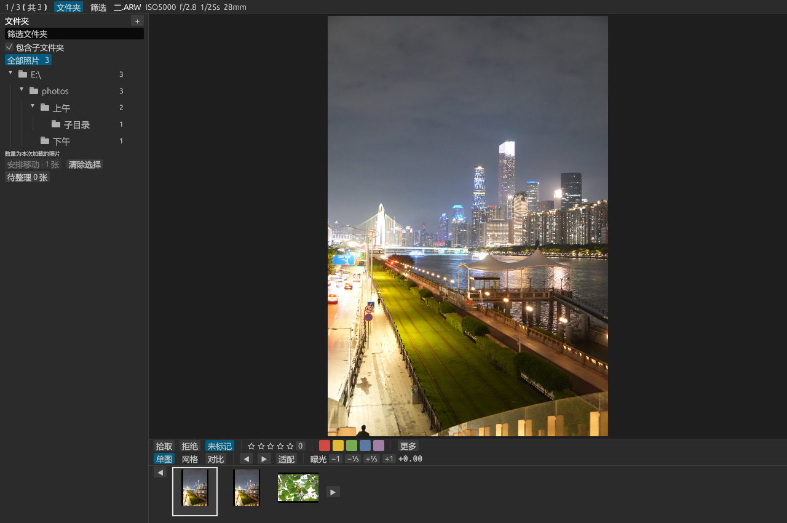
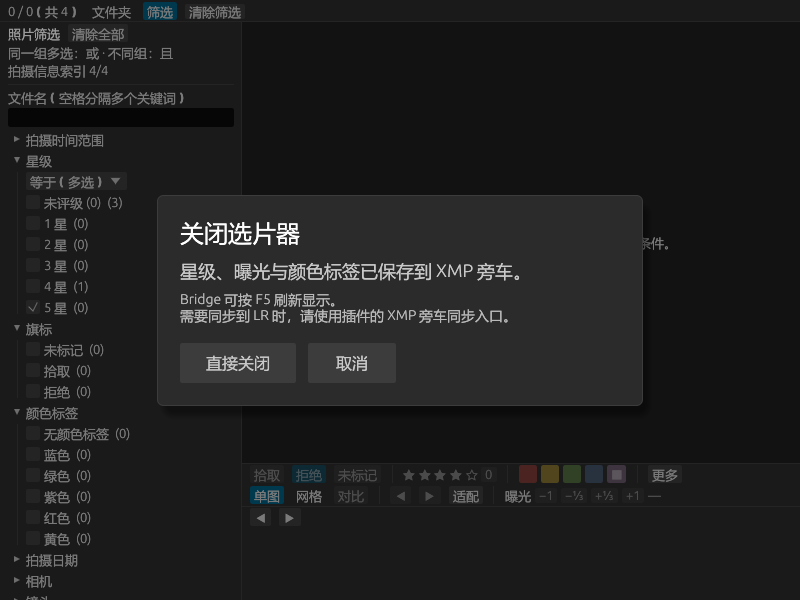

# Adobe Bridge 与快捷入口：2.4.0

## 2.4.0：CR2、NEF 与 JPG/JPEG

本版支持 ARW、CR2、NEF、JPG/JPEG，Bridge 菜单、LR 打开与手动同步、独立入口采用相同范围。其他 RAW 按用户要求留待后续检查。JPG 修改内嵌 XMP，RAW 继续使用旁车；移动 JPG 时不会带走同名 RAW 的旁车。升级须保留原生 DLL，重新启动 Bridge／重新载入 LR 插件；见 [格式说明](FORMATS.md)。文件树和拖拽反馈沿用 2.3.1 修正。

## 2.3.1：混合选择与文件树反馈

混选 JPG、其他格式 RAW、视频、XMP/ACR 等文件时，只把 ARW 和文件夹交给选片器；Rust 助手也会过滤清单中的不支持文件，直接打开 exe 的入口同样处理。全部文件都不支持时报告没有 ARW；有效 ARW 的访问错误仍报告具体路径。跳过的文件不会加载或写入。

文件树给滚动条预留独立空间，数量列右对齐；整个文件夹行含数量都可接收拖放。有效目标显示移动光标和蓝色边框，同一文件夹、排队照片、不可用模式或损坏整理记录显示禁止光标和红色边框。释放在无效目标上不提交移动。重名、权限与磁盘状态仍在提交移动时检查并报告。

138 项回归与两个尺寸的原生文件树检查通过。记录见 [tree-validation-2.3.1.json](tree-validation-2.3.1.json)。本版检查使用原生 Rust 启动链、Bridge/LR 合同测试和私有样片；真实 Bridge 菜单回调与跨卷移动的既有验证见 2.3.0 记录。

## 2.3.0：实际移动照片

Bridge 选片器新增实际移动 ARW 与 XMP/ACR 的后台队列。支持 Ctrl／Shift／Ctrl+A 多选、拖到文件夹、右键目标文件夹或“移动”弹窗；目标也可粘贴路径。M／“移到上次位置”记住本次会话上次目标，默认移动后切到下一张，实现连续整理。队列中的其他照片仍可浏览，完成后文件树与评分写入路径实时更新；窗口关闭会等待队列完成。LR 仍使用完整保留目录记录的整理计划，不做物理移动。

同名照片或旁车不覆盖，失败显示已完成数量并尝试回退本张，保留恢复记录。操作及边界见 [FOLDERS.md](FOLDERS.md)，验证记录 [bridge-validation-2.3.0.json](bridge-validation-2.3.0.json)。

## 2.2.3：支持选中文件夹

此前脚本直接跳过文件夹，Rust 清单校验也只接受 ARW 文件，因此选中多个文件夹无法启动。现在支持一个或多个实体文件夹，以及 ARW 与文件夹混选；递归读取子目录中的 ARW，忽略其他格式。按选择顺序处理根路径，各文件夹按路径排序遍历；重叠的父子目录及重复照片只加载一次。多个照片目录自动展开既有文件树，不增加额外面板。

Bridge 菜单只收集根路径，Rust 启动助手只验证根路径并分离启动，递归扫描在独立进程中完成，避免扫描阻塞 Bridge 菜单。大目录或慢速磁盘仍需等待扫描结束才出现窗口；本次没有把目录扫描变成边扫描边显示。没有 ARW 或目录无法访问时会明确报错。递归时跳过后代符号链接与 Windows 重解析点，避免循环或进入其他目录；明确选中的链接目录允许作为根目录加载。打开入口不写入照片或 XMP。

125 项回归通过（72 Rust、44 Python、9 脚本合同），Clippy 无警告。真实 Bridge ExtendScript 使用私有 File/Folder 对象混选，通过照片右键菜单回调启动 Rust；四个入口含父子重叠及单独文件，GUI 正确加载三张照片并自动显示文件树，五帧烟测通过。启动助手此次返回用时 672 ms，该数值不是大目录或所有机器的窗口耗时。证据 [bridge-validation-2.2.3.json](bridge-validation-2.2.3.json)。本机脚本和 exe 已更新，后续启动加载新版；未更改用户真实选区与照片。



## 2.2.2：修复打开时的 Syntax error

Bridge 原生 ExtendScript 引擎执行路径校验正则 `/[%!"\r\n\0]/` 时抛出错误 8（Syntax error），Node 的正则引擎接受它，因此此前合同测试没有发现。改为逐字符检查，仍拒绝 %、!、引号、换行和 NUL；照片文件名中的 % 与 & 留在 UTF-8 清单中，不进入命令行。命令明确通过 cmd.exe /d /v:off /s /c 执行，避免直接执行器与 shell 的引用差异。错误提示补充步骤、错误号和行号。

已在当前 Bridge 16.0.8.10 内重新载入修正版，原生校验中文安全路径、六种非法字符、两个菜单和真实 Rust 命令调用均通过。真实照片右键回调用三张私有 Sony 样片完成请求、分离进程、GUI 和自动关闭的五帧测试；没有更改真实选区和真实照片。此次是 Bridge 原生执行验证，区别于 2.2.1 的 DOM 模拟验证。

120 项回归（68 Rust、44 Python、8 脚本合同）及 Clippy 通过，证据 [bridge-validation-2.2.2.json](bridge-validation-2.2.2.json)。正式包和项目脚本已更新；当前机器已热加载，正常再次点击右键入口即可，后续启动使用新文件。

## 本机启用

已安装启动脚本到本机的 Bridge 2025 / 2026 用户目录。正在使用的 Bridge 2026 程序版本为 16.0.8.10；旧版用户目录存在不代表旧版程序仍安装。

1. 重新启动 Bridge。若提示发现新启动脚本，启用 **FastCull**。
2. 如果没有菜单，打开 **编辑 → 首选项 → 启动脚本**，勾选 FastCull 后重新启动。
3. 在内容面板选中 Sony ARW 或一个/多个包含 ARW 的文件夹，右键 → **FastCull · 打开选片器**。
4. 同一个入口也在 **工具 → FastCull · 打开选片器**。混选支持 ARW 和实体文件夹，子目录递归加载；忽略其他文件格式并去重。

评分、颜色与曝光直接读写 XMP 旁车；Bridge 未更新显示时按 **F5**。打开时只传照片路径，不导出默认零星级，不覆盖原有旁车。当前仍以 ARW 为支持范围。

Bridge 的关闭提示采用两项按钮，修改在选片时已写入旁车。它不创建 Lightroom 会话，也不触发 Lightroom 自动同步；如果照片同时在 LR 目录中，需要在 LR 使用“同步选中照片（从 XMP 旁车）”。两端不要同时编辑同一照片的元数据。

Bridge 模式可使用筛选、曝光、对比、文件夹树、新建文件夹和实际文件移动；LR 文件整理计划仍要求从 LR 打开。自定义拾取/拒绝旗标沿用现有 sr:Flag 协议，并非 Bridge 的 xmp:Rating=-1 拒绝标记，不能把两者当作已经双向兼容。

## 在另一台电脑安装

### 本机启动异常记录（2026-10-13）

本次“点击后无反应”时发现一个自 10 月 11 日起残留、无窗口的 Bridge 进程，新启动进程反复在 dvacore.dll 的退出/清理路径访问异常。停用 FastCull 文件仍能复现。排查中一度以为更换界面语言有效，后续中文复测正常，未确认语言是根因。

最后在确认全部旧 Bridge 进程完全退出后，恢复完整原始偏好（含中文界面）及 FastCull 脚本文件，照片浏览窗口正常启动且没有新的崩溃。没有重装、手动清理照片缓存或修改照片元数据。原偏好恢复备份位于本机 %LOCALAPPDATA%/FastCull/bridge-recovery/20261013/Bridge2026-original-preferences.reg。

对照结果见 [启动恢复记录](bridge-startup-recovery-20261013.json)。若再次出现相同现象，先检查任务管理器里的 Adobe Bridge 进程是否在退出后仍残留；不要在有正常窗口或任务运行时直接结束进程。FastCull 的正常脚本授权仍需在 Bridge 内启用，文件存在不等于菜单已生效。

将整个发布包解压到长期目录，以 PowerShell 7 运行：

```powershell
& './scripts/install-bridge.ps1'
```

安装器同时兼容源码目录和解压发布包；可指定：

```powershell
& './scripts/install-bridge.ps1' -BridgeVersions 'Bridge 2026'
& './scripts/install-bridge.ps1' -Executable 'D:/FastCull/FastCull.lrplugin/fastcull.exe'
```

安装位置为 **%APPDATA%/Adobe/Bridge YYYY/Startup Scripts/**，仅写入 FastCull.jsx 与 FastCull-path.txt。更新时备份这两个文件，不改变其他启动脚本或 Bridge 偏好设置。配置中的 exe 路径属于机器本地；项目移动后重新运行安装器。程序和请求目录不支持 % 或 ! 字符，照片名称中的这些字符不受此限制。

## 键盘访问与宿主限制

2.5.1 起，Bridge 与 Lightroom 统一使用 **Ctrl + Alt + K** 打开选片器。更新后重启 Bridge，并在 LR 增效工具管理器重新载入插件。快捷键仅在对应 Adobe 主窗口处于前台时注册，详细行为和验证边界见 [快捷键说明](HOTKEYS.md)。

Bridge 的 MenuElement 没有直接注册快捷键的属性，因此由随插件分发的 Rust 助手接收按键，再调用现有菜单入口。不会修改 Adobe 的快捷键配置，照片右键入口继续可用。

LR 已为打开菜单增加 **(&F)** 助记键：在 **图库 → 增效工具额外命令** 的插件命令菜单展开后按 **F**。更新后需在增效工具管理器重新载入插件；这是菜单助记键，不是任意界面下按 F 启动。公开 LR SDK 的菜单扩展是图库/文件菜单，不提供新增照片右键命令的接口。

## 历史验证边界（2.2.1）

118 项回归通过：68 Rust、44 Python（含 LR SDK 私有 GUI 回合、安装器、日志分析与像素检查）、6 ExtendScript 入口合同测试；Clippy 无警告。入口测试覆盖重复注册、空/混合选择、中文特殊文件名、5,000 张列表、缺失程序和启动失败。

Windows cmd.exe → Rust 分离进程 → 原生 GUI 的私有 Sony 样片链路通过，助手返回约 0.18 秒，13 帧检查图像、曝光、独立及相对联动对比、筛选和 Bridge 关闭框。总烟测时间包含主动等待和全部交互，不是打开窗口延迟；管道模式内存数值为未测量。

本机启动脚本文件已注册并核对。Bridge 内实际启用后的菜单显示和鼠标点击尚待真实宿主验收，未把 DOM 模拟测试描述为真实 Bridge 点击验证。原有 LR 文件整理的真实目录验收边界保留在 [FOLDERS.md](FOLDERS.md)。



## 接口依据

- [Adobe Bridge 开发入口](https://developer.adobe.com/bridge/)：使用 ExtendScript 开发 Bridge 插件。
- [Adobe ExtendScript 文档：XMP 与 Bridge 集成](https://extendscript.docsforadobe.dev/scripting-xmp/accessing-the-xmp-scripting-api/)：Thumbnail 照片右键菜单扩展，启动脚本加载。
- [Adobe Bridge JavaScript Reference](https://basearts.com/curriculum/PDF/scripting/Bridge%20JavaScript%20Reference.pdf)：MenuElement、app.system 和脚本菜单快捷键限制；这是 Adobe 作者的旧版接口文档镜像。
- [Adobe 官方快捷键设置说明](https://helpx.adobe.com/ca/bridge/desktop/get-started/keyboard-shortcuts-panel.html)：编辑菜单中的快捷键面板。
- [Lightroom Classic SDK Guide](https://ioconsolerykerprodcdn.azureedge.net/static/installers/lr/sdk/2022/cross_platform/v13/doc/Lightroom%20Classic%20SDK%20Guide_1655133965.pdf)：Windows 插件菜单 title 中的 & 助记键。
## 2.5.0 启动更新

运行新版 `scripts/install-bridge.ps1` 后，Bridge 使用 `File.execute()` 打开私有 `.fastcullrequest` 请求，由 Windows 直接启动 FastCull。安装仅注册当前用户的 `FastCull.Request` 类型，不修改 RAW/JPEG 默认应用。窗口先显示，之后后台扫描选择的文件夹。旧安装没有关联标记时继续使用原命令入口。

本机真实 Bridge 2026 脚本回调测试：启动调用 153 ms 返回，窗口首帧距回调开始 499 ms，首张照片 825 ms。历史旧命令入口的请求到进程启动为约 5.8 秒。时长属于本次私有样片测试，不保证每台机器或冷启动完全相同。记录见 `startup-validation-2.5.0.json`。
