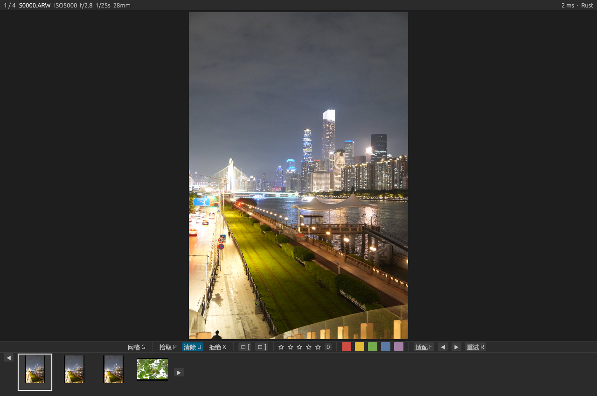
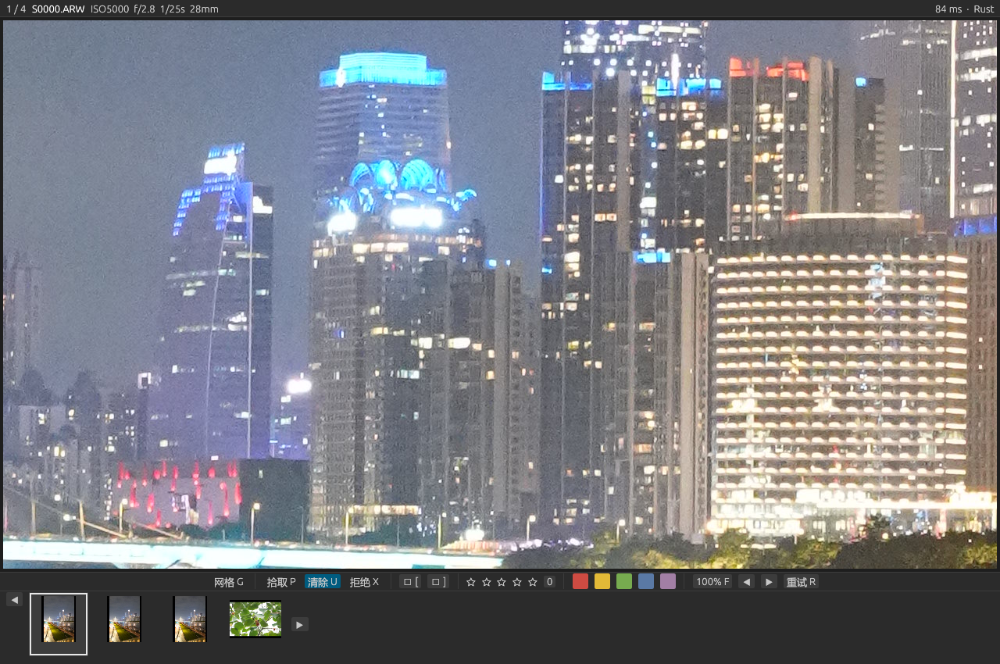
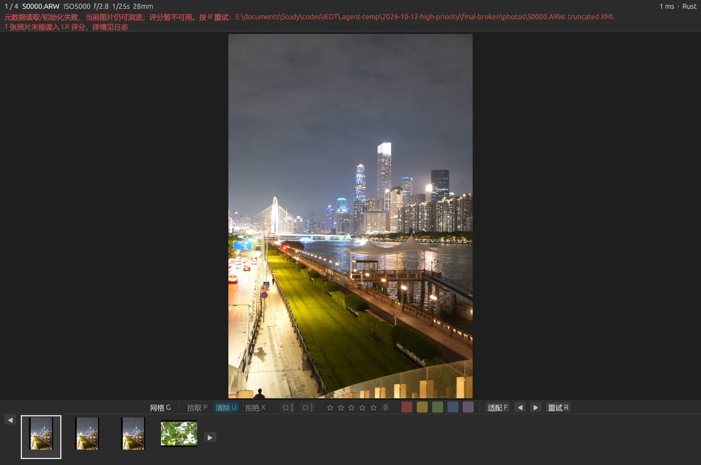
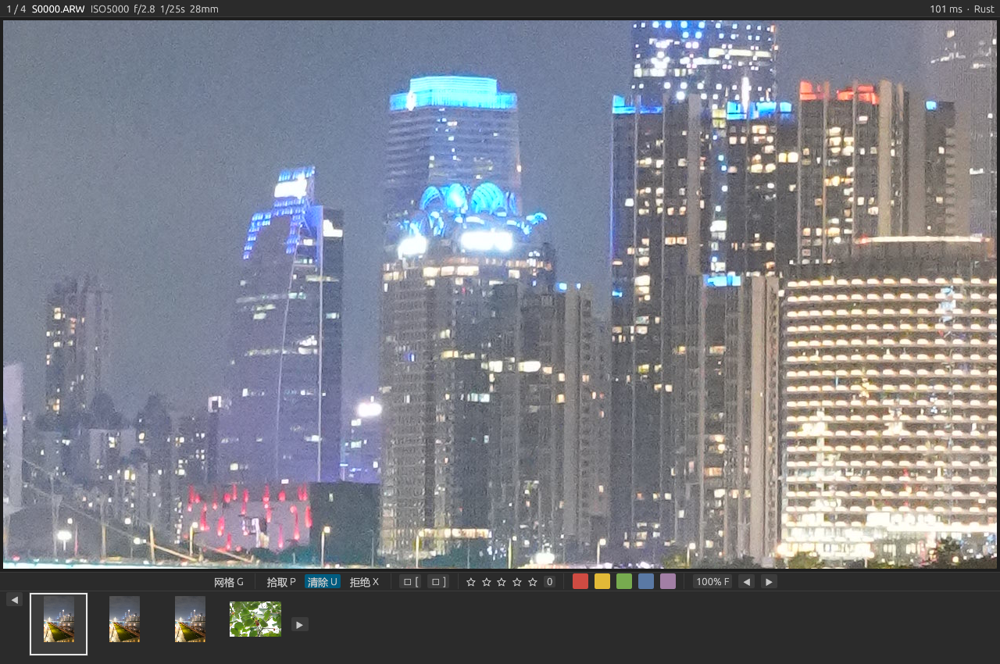
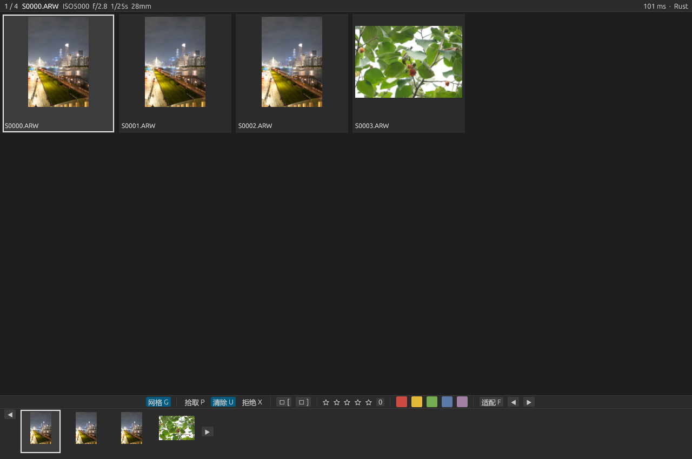
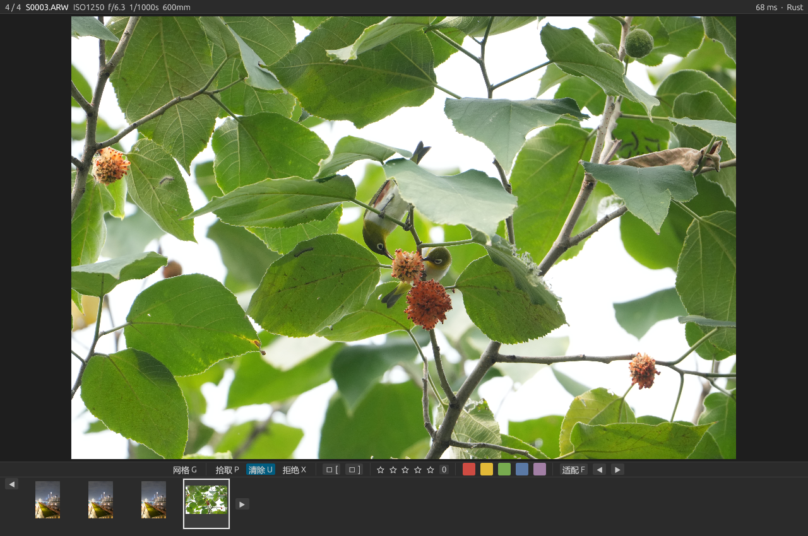
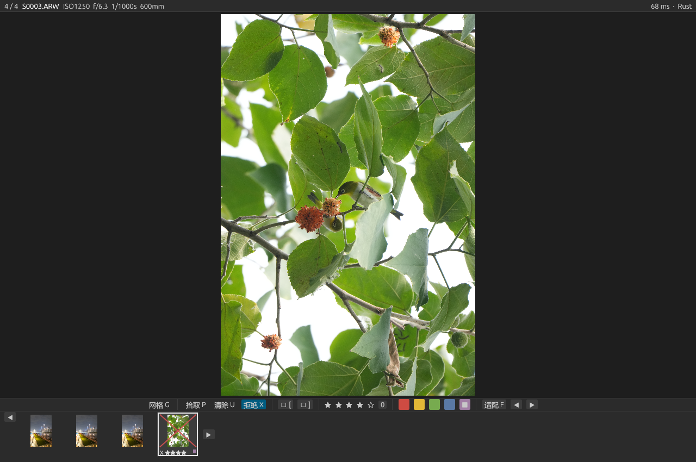

# FastCull Rust 开发验收记录

## 2.4.0：CR2、NEF 与 JPEG（2026-10-13）

按用户最新范围仅启用 ARW、CR2、NEF、JPG/JPEG。Rust 保持界面、缓存、JPEG 解码、筛选、同步与移动；LibRaw 原生适配层提供 CR2/NEF 元数据、最大内嵌预览和分辨率不足时的 RAW 回退。试测发现有效输出区小于含边缘传感器区，错误触发完整解码；改用厂商裁剪和 EXIF 输出尺寸，保持已有全尺寸 JPEG 的高速路径。

JPG 标准内嵌 XMP 原子更新、已有 EXIF 方向一致性、压缩图像流保留、与同名 RAW 旁车隔离均有回归。LR 手动同步改用共同支持列表，实际读取 JPEG 内嵌评分；关闭说明更新为照片元数据。91 Rust、45 Python、10 脚本合同，共 146 项通过；Clippy 无警告。当前格式与实际样片边界见 [FORMATS.md](FORMATS.md)，原生窗口、分辨率、耗时及文件内容证据 `formats-validation-2.4.0.json`。可重建资料在 `.agent-temp/2026-10-13-multiformat/`；正式包包含原生 DLL 与可重建上游源码，不依赖临时目录。

## 2.3.1：混合选择、数量列与拖拽反馈（2026-10-13）

先用 Rust 回归复现 ARW 与 JPG 混选导致整批失败；修正原生 Bridge 清单入口和直接打开程序入口，未知格式跳过，全部不支持时报告没有 ARW。Lightroom 与 Bridge 脚本已有的格式过滤增加混选覆盖，既有元数据同步不扩大到其他格式。

文件树使用独立的 8px 滚动条和 6px 内侧间隔，名称与右对齐数量在同一行内分配空间。有效／无效拖放目标分别设置 Move／NotAllowed 光标和蓝／红边框；无效释放不提交，拖放时关闭树内容拖动滚屏，保留滚轮与滑轨操作。排队集合只在请求或完成事件后更新，避免每帧复制大批队列。

85 Rust、44 Python（含私有 LR SDK 原生 GUI 回合）、9 ExtendScript 合同，共 138 项通过；Clippy 无警告。220/360px 侧栏布局回归检查计数不与滑轨相交。1280×850、640×480 两个原生窗口分别用 284 张私有样片和混选文件运行 5 帧，检查数量、目标边框及平台光标输出；直接 exe 混选另运行 5 帧。跳过的 JPG/CR3/XMP/视频内容未变，全部不支持的两种原生入口返回明确错误。截图不包含操作系统鼠标位图，光标检查依据原生平台输出断言。真实 Bridge 菜单点击和跨卷移动本轮未重复执行；已有验证见 2.3.0。

正式记录 `tree-validation-2.3.1.json`，界面 `images/rust-2.3.1-folder-tree.png`、`images/rust-2.3.1-folder-tree-small.png`；可重建样片和探针在 `.agent-temp/2026-10-13-tree-feedback/`，交付包不依赖该目录。

## 2.3.0：Bridge 连续/批量实际移动（2026-10-13）

新增 `relocating` 的无覆盖文件移动与逐照片回退、持久记录，以及串行后台 `move_jobs` 队列。解码/元数据读取与移动共享每张照片的路径读写锁，GUI 只在成功事件后更新路径；图片索引、缓存和相对对比锚点保持不变。排队照片禁用评分，其他照片可继续浏览/编辑；退出等待队列完成。批量准备按源目录缓存清单与 canonical 路径，执行前做常量个数重检，避免逐照片全目录扫描。

81 Rust、44 Python（含原生 LR GUI 回合）、9 脚本合同，共 134 项回归通过，Clippy 无警告。新增测试覆盖连续与批量、再次移动、评分新路径、相对对比保持、关闭等待、输入隔离、旁车大小写、冲突/回退、复制路径、排队后新旁车与目标孤立旁车。

私有 Sony 样片运行 1280×850 和 640×480 原生 GUI，各 21 帧；小窗口由实际 Bridge 原生 File/Folder 混选及右键菜单回调启动，常规窗口验证 E→C 实际跨卷移动。RAW 哈希不变，移动后的评分/曝光继续写新 XMP，文件树与数量正确，曝光/对比像素核验通过。未修改用户真实选区或真实照片。证据 `bridge-validation-2.3.0.json`，界面 `images/rust-2.3.0-bridge-move.png`、`images/rust-2.3.0-bridge-move-small.png`。可重建探针、样片和日志在 `.agent-temp/2026-10-13-bridge-moves/`；跨卷目标在另一个已授权工作区的同名 `.agent-temp/` 中。

Windows 使用 [MoveFileExW](https://learn.microsoft.com/en-us/windows/win32/api/winbase/nf-winbase-movefileexw) 的不覆盖重命名；不同卷显式暂存复制、校验复制长度/源大小与修改时间、刷盘、不覆盖发布，再删除源文件，避免 COPY_ALLOWED 在源文件未删除时仍返回成功的语义。记录用于人工恢复，不宣称 RAW 与多个旁车或整个批次在断电情况下原子提交。Bridge 物理移动不会更新 LR 目录。

## 2.2.3：Bridge 多文件夹入口（2026-10-13）

Bridge 脚本改为收集 ARW 与实体目录的根路径，独立 Rust 进程递归展开；父子重叠目录和重复文件去重，目录链接循环跳过，空目录/访问失败报错。沿用现有文件树，不写入默认评分、不移动照片。72 Rust、44 Python（包含原生 GUI/LR 会话）、9 脚本合同共 125 项通过，Clippy 无警告。

真实 Bridge ExtendScript 原生 File/Folder 对象混选与右键回调使用私有样片通过，四个入口展开为三张照片、GUI 五帧及文件树视觉核验通过。记录 `bridge-validation-2.2.3.json`，界面 `images/rust-2.2.3-bridge-folders.png`；可重建探针、样片和日志放在 `.agent-temp/2026-10-13-bridge-folders/`。没有模拟用户鼠标动作或修改真实照片。大目录扫描仍在窗口创建前完成，不能据此保证任意目录瞬间显示。

## 2.2.2：Bridge 原生 Syntax error 修复（2026-10-13）

原生 Bridge 16.0.8.10 在原始 api.quote 路径正则的 NUL 转义处报错误 8，同样表达式在 Node 中通过。直接在真实 Bridge 引擎复现红色失败，修复为字符检查后，原生 api.quote、安全路径、六种非法字符、两个菜单、Rust 帮助调用均通过。执行器显式使用 cmd.exe，错误提示含步骤、编号和行号。

实际 Bridge 右键回调使用三张私有样片跑通 Rust 启动、真实 GUI 五帧和自动关闭；真实选区与真实照片未改动。120 项回归及 Clippy 通过。正式记录 `bridge-validation-2.2.2.json`，原生界面 `images/rust-2.2.2-bridge-native.png`；临时探针与样片仅在 `.agent-temp/2026-10-13-bridge-syntax/`。不将私有样片程序化调用描述成真实照片的人手点击验收。

---

## 2.2.1：Adobe Bridge 与快速入口（2026-10-13）

Bridge 新增照片右键及工具菜单，传递 UTF-8 路径清单，经 Rust 助手分离启动，直接读取 XMP。5000 张列表使用固定长度命令，不应用宿主默认零评分；本机 Bridge 用户启动脚本已注册并与正式源码核对。LR 打开菜单添加 F 助记键；Bridge 使用照片右键入口，Shift+F10 尚未在宿主实机确认，未伪造直接热键接口。

118 项回归通过（68 Rust、44 Python 含 SDK 私有原生 GUI 回合与安装器、6 ExtendScript 合同），Clippy 无警告。最终 exe 的 Bridge 命令行到原生窗口链路通过 13 帧功能与像素检查，关闭框字号和布局已目视检查。正式证据 `bridge-validation-2.2.1.json`、图片 `images/rust-2.2.1-bridge-close.png`、操作说明 [BRIDGE.md](BRIDGE.md)。脚本注册、DOM 合同模拟和 Rust 原生窗口验证不等于真实 Bridge 菜单点击验收；需要在 Bridge 重启后启用启动脚本。

---

## 2.2.0：文件夹树与保留原对象的整理计划（2026-10-13）

按用户确认的完整保留编辑历史、集合关系和虚拟副本方案实现：文件夹树自动显示多文件夹会话，可按目录/后代联合元数据筛选，搜索和创建实际目录；Ctrl/Shift/Ctrl+A 选择，拖到目录或使用“安排移动”保存计划。原始路径与照片索引不变，移动计划独立原子保存，允许取消，并检查原图/旁车重名。损坏记录不覆盖。

有计划时，退出确认明确同步修改及整理计划；先按原会话同步星级、曝光、旗标和标签，再创建 LR 待整理集合并选择第一组原对象。实际移动由 LR 原生操作完成。原 UUID 路径用于完成核对，完成后定位下一组；不移出目录、重新导入、删除原集合或直接修改目录数据库。整理失败与字段确认进度独立，重试不重复曝光历史；新集合提交后才在下一写入事务加入照片。

108 项回归通过：66 Rust、38 Lua/SDK、2 日志分析、2 像素检查；Clippy 无告警。覆盖身份、跨盘/组件、联合筛选、批量选择、输入隔离、长路径、重名、保存失败、虚拟副本、事务未执行、失败重试与自动关闭。

正式 1280×850 和 640×480 窗口各 19 帧已视觉检查：文件夹左对齐、矢量图标、选中高亮，创建/计划/取消/关闭弹窗均清楚且在窗口内。创建了实际目录、保存了两张计划，并用 SHA-256 确认私有 RAW 副本不变。最小窗口像素检查第一次误计入侧栏灰色像素，修正画布边界并追加曝光侧栏和独立双画面两个检查；相同误差阈值下，小窗口平均误差 0.402/255（369 通道），常规窗口 0.401/255（3210 通道）。

正式证据 `folders-validation-2.2.0.json`，截图 `images/rust-2.2.0-*.png`；操作说明 [文件夹树与整理计划](FOLDERS.md)。正式程序已复制到项目插件，安装包 `dist/FastCull-Rust-2.2.0-win64.zip`。本次中间文件 `.agent-temp/2026-10-13-folders/`；交付物不依赖该目录。

未操作真实 Lightroom：原生选片器与 SDK mock 不替代真实 LR 集合定位、目录拖动和数据保留验收。管道测试内存 0.0 表示未采集，不表示零占用；19 帧完整测试时间不作为普通选片响应时间，也未重测启动性能。

---

## 2.1.2：关闭框与对比相对联动（2026-10-13）

关闭框内容宽 440px、边距 22px，标题/正文/说明为 24/18/14px，按钮为 16px 文字及 40px 高度。常规 1280×850 和最小 640×480 原生截图均已视觉检查，字号和留白增大，三个原有动作保持。

对比原先在联动开关、滚轮、拖动、上下键及放大入口复制整个视图，导致另一张图已对准的主体跳位。新增回归先实际失败（B 应由 100% 变为 200%，旧代码将其复制为 A 的 100%），修正为共同缩放倍率及共同图像比例移动增量。各自锚点不被覆盖，到边缘共同限制平移；切换候选保留参考图的位置和倍率。适配显示全图，保留锚点供再次放大使用。

89 项回归通过（56 Rust、31 Lua/SDK、2 日志分析），Clippy 无告警。两个实际窗口测试在分别设置不同主体偏移后调用正式缩放/平移入口，验证锚点差仍为 (0.11, −0.06)，解除联动仅移动活动图；原生退出后的会话星级收据与桥接保持通过。截图与数字见 `features-validation-2.1.2.json`、`images/rust-2.1.2-*.png`。本次不重复旧启动性能测量，也未验证真实 LR 目录同步。

正式安装包 `dist/FastCull-Rust-2.1.2-win64.zip`；本次中间文件在 `.agent-temp/2026-10-13-relative-link/`，分发包不依赖该目录。

---

## 2.1.1：需求与 UI 组合核对（2026-10-13）

逐项需求、实现范围与验证边界见 [需求与交互核对](UI-ACCEPTANCE.md)。新增回归先复现了快速“打星＋翻片”的处理顺序错误、对比照片切换被忽略、上下键未作用于对比画面和纯星级会话未移出待同步列表；修正后通过。菜单与筛选文本输入保留自己的按键；组合测试检查筛选、对比、曝光和打星使用同一原始照片身份，避免写入另一张。

界面改为评分行及查看/曝光行，星级、标签色块和四档曝光控制分别完整换行，旋转、重试和日志收纳到“更多”。对比画面减少重复提示与重复 100% 文本，选中控件和蓝框明确活动对象；无结果时隐藏旧文件名。最小 640×480 窗口带 242px 筛选侧栏，工具条高度不超过 112px，保持照片区域。自动同步成功不再额外弹 LR 成功框，失败仍提示并保留会话。

85 项回归（52 Rust、31 Lua/SDK、2 日志分析）及 Clippy 通过。一次曝光保存回归出现未记录具体原因的保存失败，此后 200 次定向曝光与 15 轮组合复测均通过；暂未稳定复现，记录该边界而不宣称所有文件访问环境都无故障。现有保存失败保留原值并显示错误。新版原生窗口与启动数据归档 `features-validation-2.1.1.json`，截图位于 `images/rust-2.1.1-*.png`；中间文件 `.agent-temp/2026-10-13-ui-audit/`。

真实 LR 的曝光显影、完整筛选操作与关闭自动同步仍需用户重新载入 2.1.1 后确认。已有 2.0.8 前台用户确认保持为历史验证，不能替代本版本全部实际目录行为验收。

---

## 2.1.0：筛选、曝光、双片对比及关闭同步（2026-10-13）

完成 Bridge/LR 风格筛选：同字段多选为或、不同字段为且；星级等于/至少/至多，旗标、标签、日期/时间、相机、镜头、ISO/光圈/快门/焦距、文件名。原照片索引与会话身份保持稳定，网格/胶片带/左右键使用筛选结果；空结果禁用评分，输入框阻断评分快捷键。拍摄信息仅在侧栏首次展开时后台索引，未索引和索引后未知分开处理。标准 TIFF EXIF 文本与数值解析限于现有 512 KiB 头部读取，不扫描 RAW 数据。

曝光四按钮 −1/−⅓/+⅓/+1 EV，三次⅓累积一档，限制 −5..+5 EV。GUI 启动后 SDK 导出当前 `Exposure2012`，无效/未解析值或旧处理版本不假定为零。曝光以整数微 EV 存入旁车和逐字段修订清单，命名空间别名与无关显影字节保持；LR 写入只传曝光参数。GPU 使用 sRGB→线性→乘以曝光增益→sRGB 的近似显示，不保留额外全尺寸 CPU 副本。机内 JPEG 不能代替完整 RAW 显影或恢复剪裁高光。

双片 A/B 以原始照片身份区分，点击选中操作对象；独立/联动适配、100%、滚轮缩放、拖动平移。联动平移按各图显示方向的尺寸比例同步，两张大图受缓存与工作队列保护，对比时停止额外大图预取。筛选排除任一对比图时退回单图，当前图片未改变时不重置平移。实际截图发现工具条在增加控件后可能占满底部可用高度，已改为行高分配的 `horizontal_wrapped` 并复查常规与最小窗口。

Q/Esc/窗口关闭均先显示确认框。取消继续选片，直接关闭保留待同步修改；确认同步则等原生 GUI 返回后才提交 `.stars-request`，LR 后台任务按原会话及目录身份自动同步星级。星级使用独立确认进度，其他字段保持待同步；缺失其他字段不阻断有效星级导出，后续新星级仍可同步。旧 V1 清单继续读取，曝光记录升级为 V2；会话同步和手动旁车同步共享 Rust XML 解析。

验收证据：46 项 Rust、30 项 Lua/SDK/实际命令桥接及 2 项日志分析测试通过；Clippy 无告警。曝光基线流只发布完整行，结束后停止轮询；追加测试覆盖半行、完成值和完成后保持缓存。原生正式窗口使用私有样片副本，13 帧包含曝光前后、独立/联动对比、筛选、无结果和关闭确认，逐帧视觉检查通过。640×480 的曝光抽样 1092 个 RGB 通道，+1 EV 与 sRGB 公式的平均误差 0.402/255；1280×850 抽样 4608 通道，平均误差 0.396/255。两个对比画面均真实呈现。仅 GUI 内部测试动作，不向外部应用模拟键盘或修改用户照片。

正式 340 张隔离启动：命令返回 171.5ms，首帧 385.1ms、首图 428.1ms，后台评分和末张后续修改保留。这不包含真实 LR 的元数据导出/SDK 调度、未清系统缓存，也不是冷启动保证。管道模式验收没有采集进程峰值，报告中的 0.0 MiB 表示未测量，不表示零内存。

真实 LR 的完整曝光写回、关闭自动星级同步与新筛选交互尚待用户重新载入 2.1.0 后复测；SDK mock 和原生选片器截图不替代真实 LR 目录验收。2.0.8 用户已确认的前台机制保持，不能把旧版确认算作新功能验收。样片包括两个真实场景与相同 JPEG 的相机型号元数据变体，不代表四个不同机型实拍覆盖。

正式插件 `lrplugins/FastCull.lrplugin/`，安装包 `dist/FastCull-Rust-2.1.0-win64.zip`；汇总 `docs/features-validation-2.1.0.json`，截图 `docs/images/rust-2.1.0-*.png`。开发中间文件在 `.agent-temp/2026-10-12-photo-filters/`，最后验收在 `.agent-temp/2026-10-13-photo-qa/`，交付文件不依赖这些目录。

参考：[Adobe Bridge 筛选规则](https://helpx.adobe.com/archive/bridge/cc/6.1/bridge_reference.pdf)、[Adobe SDK LrPhoto API 文档镜像](https://lrc.mcor.dev/modules/LrPhoto.html)、项目使用的 egui_glow 0.33.3 源码（纹理为普通 sRGB 字节，回调后恢复 painter 状态）。

---

## 2.0.8：原生前台核验与真实 LR 确认（2026-10-12）

2.0.7 已由真实 LR 验证启动加速：340 张元数据 24.3ms，菜单入口至首帧 475ms、首图 572ms，但用户报告仍在后台。父进程前台授权为 true，旧 GUI 只记录框架焦点请求，未核验 Windows 实际前台。

新增 `src/focus.rs`，用实际 HWND、`IsWindowVisible` 和 `GetForegroundWindow` 判断。可见后通过普通 z-order/原生前台激活，必要时仅在原发起进程仍为前台时短暂 `AttachThreadInput` 并用 RAII 立即断开。最多三次激活、间隔至少 100ms、启动窗口 1.5s；已核验前台、用户切换应用或超时后停止。不永久置顶，不模拟键盘输入。保留 SDK 协作执行和分离启动。

用户重新载入 2.0.8 后确认“现在会自动显示前台了”。对应真实 340 张日志：元数据 50.2ms，菜单入口至首帧 489ms、首图 591ms，前台核验为 true；本次无需额外激活（attempts=0），后台初始化 kept=340/error=0。随后真实 100% 大图一次 ready 106.9ms。这是当前机器少量运行数据、到应用绘制帧，不含物理显示器呈现，未清系统缓存，不能当作冷启动保证。

35 项 Rust、26 项 Lua/SDK/原生 GUI 和 2 项日志分析回归通过，Clippy 无告警。三项新增策略回归覆盖隐藏窗口保留激活机会、原生前台确认后停止、用户切换应用与次数/时限。正式额外管道回归返回 120.8ms，窗口/关闭会话正常，原生前台 true。短暂输入线程连接的兜底分支本次实测未触发，策略测试不能替代该分支在所有桌面环境中的验证。

正式插件 `lrplugins/FastCull.lrplugin/`，分发 `dist/FastCull-Rust-2.0.8-win64.zip`；原始计时与隔离测试在 `.agent-temp/2026-10-12-focus-window/`，汇总归档 `docs/focus-validation-2.0.8.json`。真实启动/前台已经用户验证；不等同于完整真实 LR 目录同步验收。

依据：[Windows SetForegroundWindow](https://learn.microsoft.com/en-us/windows/win32/api/winuser/nf-winuser-setforegroundwindow)、[AttachThreadInput](https://learn.microsoft.com/en-us/windows/win32/api/winuser/nf-winuser-attachthreadinput)。

---

## 2.0.7：SDK 协作执行与窗口焦点（2026-10-12）

用户复测计时版 2.0.6，仍报告约五秒且 GUI 不到前台。真实关联日志精确记录：任务排队 1ms、元数据 23.1ms、popen 创建 35.9ms、阻塞读取 5850.9ms；调用至 Rust 最早 `main` 为 5792ms。GUI 入口至首帧 579ms，其中窗口/图形初始化 562ms、字体配置 6.8ms。删除控制台调用没有解决主要延迟。

SDK 文档说明 `startAsyncTask` 是 LR 主线程上的协作协程，并非独立 OS 线程；原来的 `io.popen:read('*a')` 阻塞该线程。改用 `LrTasks.execute` 等待命令，只暂停当前任务，允许 LR 消息循环继续。输出重定向到 UUID 命名的临时文件，执行完成后读取并清理；非零退出或无输出报告具体错误。覆盖原生打开和同步命令，Python 回退保留旧行为。新计时记录 `execute-start/return` 与 `file-read`。

Windows 启动器创建 GUI 后调用 `AllowSetForegroundWindow`，权限被拒绝时只记录、不把已成功启动报成失败；GUI 设置 active，并在首帧之后的可见窗口帧发送一次 `ViewportCommand::Focus`。不使用永久置顶，也不在每次翻片时抢焦点。是否获准前台仍受 Windows 当前用户输入规则约束，需真实 LR 用户复测。

32 项 Rust、26 项 Lua/SDK/实际 GUI、2 项日志分析回归通过，Clippy 无告警。新增 SDK 执行回归先在旧实现触发“native launch used blocking io.popen”，再验证切换执行路径、退出码错误、临时输出清理及状态格式保持。可选原生 GUI 回归现在走真正的 `Common.runCuller` 和 Windows C-runtime shell/输出文件路径，再验证会话关闭、切换 LR 选区后的字段同步；仍为 SDK mock，不模拟真实 LR 消息循环。正式 release 的额外隐藏管道句柄测试返回 131.0ms并绘制成功、关闭会话。

正式插件在 `lrplugins/FastCull.lrplugin/`，分发包 `dist/FastCull-Rust-2.0.7-win64.zip`。临时数据保留在 `.agent-temp/2026-10-12-startup-stages/`。32+28 项回归证明协议和原生窗口流程可用，不能据此替代真实 LR 的菜单到首帧耗时及前台显示验证。

依据：[Adobe SDK LrTasks 协作协程与 execute 说明（文档镜像）](https://archive.stecman.co.nz/files/docs/lightroom-sdk/API-Reference/modules/LrTasks.html)、[Windows 前台权限规则](https://learn.microsoft.com/en-us/windows/win32/api/winuser/nf-winuser-allowsetforegroundwindow)。

---

## 2.0.6：真实 LR 启动等待的分段定位（2026-10-12）

2.0.5 修复启动失败后，用户确认单张照片仍需约五秒出窗口。读取同一次真实 LR 的插件与 Rust 日志：`[run]` 位于 22:05:57，启动进程第一条日志 Unix 时间为 1791813962888ms；因前者只有整秒精度，该段等待为 4889–5888ms。GUI 第一条日志到首帧为 711ms。该证据只能定位到外部调用至程序首次日志的区间，无法区分 shell/进程加载、入口控制台调用和日志初始化；也不包含菜单点击至元数据导出的时间。

本版删除入口的 `SetConsoleOutputCP(65001)`。Rust 标准输出在管道中写原始 UTF-8，控制台中已有编码适配，因此无需为 LR 额外访问控制台。这里只消除一个可能等待的调用，尚未据此断言真实 LR 的五秒延迟已消失。

加入持久的启动性能日志：Lua 使用 `LrDate.currentTime()` 墙钟，覆盖菜单入口、异步任务开始、选区、批量元数据、会话路径、状态写完、外部调用、popen 返回、读取返回、关闭管道和已记录会话。Rust 在日志初始化前捕获最早入口的 Unix 毫秒，并记录日志初始化、会话准备、图形/窗口入口、应用构造、字体配置、线程池和首帧。计时异常不影响业务流程。`scripts/analyze_startup.py` 按会话 ID 关联两边日志，旧版整秒日志以区间呈现，避免伪精度。

新增测试先证明旧版缺少宿主等待和任务排队记录，再验证注入的五秒 popen 等待与 0.1 秒读取分别可见、两秒任务排队计入、SDK 时钟失败仍可启动；日志分析测试验证会话隔离、日志初始化前入口时间及旧记录的不确定区间。32 项 Rust、24 项 Lua/SDK/实际 GUI 与 2 项日志分析回归通过，Clippy 无告警；中文路径错误的管道输出仍为有效 UTF-8。正式 release 通过不能修改的标准流、隐藏管道、普通管道三项原生启动测试（122.8/118.0/130.6ms），并完成窗口绘制和会话关闭。

2.0.6 为过程中使用的计时版，之后合入 2.0.7 发布；临时复现、旧 exe 与测试目录在 `.agent-temp/2026-10-12-startup-stages/`。随后用户重新载入 Lua 并点击打开，确认仍需五秒；新计时结果用于上面的 2.0.7 修正。独立进程和 SDK mock 测试不证明实际 LR 延迟已解决。

依据：[Rust Windows 标准输出实现](https://raw.githubusercontent.com/rust-lang/rust/1.90.0/library/std/src/sys/stdio/windows.rs)、[Adobe SDK LrDate.currentTime 的 Cocoa UTC 时钟说明](https://lrc.mcor.dev/modules/LrDate.html)。后者为 SDK API 文档镜像。

---

## 2.0.5：Windows 标准流句柄拒绝访问（2026-10-12）

用户在 LR 打开时收到 `clear inherited stdio: 拒绝访问 (os error 5)`。旧版会对 `GetStdHandle` 返回的句柄调用 `SetHandleInformation`；部分句柄不能修改继承标志，因此在创建 GUI 前失败。用 Win32 启动旧版、给标准输入传入不能修改标志的伪句柄，实测复现同样的 error 5。该回归模拟句柄条件，没有断言真实 LR 使用的具体句柄类型。

另外给启动进程传入一个标准流表以外的可继承管道写句柄，旧版即使清除了三个标准流的标志，GUI 仍继承隐藏句柄，LR 风格的读取一直等到窗口关闭：本次旧版实测 6384.6ms。两项最小复现分别记录在 `.agent-temp/2026-10-12-launch-handles/old-invalid/` 和 `old-extra/`。

新增 `src/launch.rs`，用 `CreateProcessW` 创建分离 GUI，`bInheritHandles=FALSE`，GUI 标准流明确为空；不读取或修改父进程的标准流句柄。完整可执行路径单独传入，参数用 UTF-16 并按 CRT 规则转义，继承环境变量和工作目录。及时关闭返回的线程/进程句柄，GUI 使用自有日志。私有状态快照在启动前关闭文件句柄，启动失败清理该快照，启动成功后仍由子进程读取并清理。

32 项 Rust 与 21 项 Lua/SDK/原生窗口回归通过，Clippy 全目标无告警。后者覆盖 SDK mock 打开入口 → 实际 Rust GUI → 关闭会话 → 更换选区后同步修改。正式 release 还单独通过三种 Win32 管道回归（中文/空格的 exe、状态及会话路径）：拒绝修改的标准输入、额外管道句柄、普通标准流。管道返回分别为 126.0、124.1、127.7ms；每项均确认窗口实际绘制、无错误并最终关闭会话。该时间是启动命令至管道 EOF，不是点击 LR 菜单至首图时间。

340 项私人复制/硬链接样片目录的 `_wpopen` 回归通过，后台评分初始化覆盖全部照片，最后用户编辑保留。第一次新版运行管道返回 163.8ms，首图进入绘制帧 1528.7ms；额外同环境顺序对照，旧版返回 172.8ms/首图 446.2ms，新版返回 161.4ms/首图 421.9ms。首图受运行环境影响明显，这些是少量启动测量，未清空系统缓存、不含 LR SDK 元数据导出和显示器呈现时间，不能当作冷启动上限或稳定分位数。完整结果保存到 `docs/launch-validation-2.0.5.json`。

该 340 项验收也发现测试脚本只等结果文件存在，偶尔会在文件创建后、内容写完前读到空串而误报。`scripts/startup_probe.py` 及新启动探针改为等待结果末尾字段完整；修复后复测通过。GUI 业务代码未因该验收竞态改变。

启动回归命令：`python scripts/launch_probe.py --exe <exe> --scratch <新目录> --mode invalid-stdin`，另外顺序运行 `extra-pipe` 和 `normal`。三种模式不得并行，以免 GUI 自动键盘输入互相影响。正式成果在 `lrplugins/FastCull.lrplugin/` 和 `dist/FastCull-Rust-2.0.5-win64.zip`；所有可重建中间文件在 `.agent-temp/2026-10-12-launch-handles/`。未操作真实 LR 目录，仍需用户在 LR 重新加载插件后实机复测。

实现依据：[Microsoft CreateProcessW：句柄继承、启动参数与资源释放](https://learn.microsoft.com/en-us/windows/win32/api/processthreadsapi/nf-processthreadsapi-createprocessw)、[CRT 命令行解析规则](https://learn.microsoft.com/en-us/cpp/c-language/parsing-c-command-line-arguments?view=msvc-170)。

---

## 2.0.4：LR 会话目录启动错误（2026-10-12）

2.0.3 在真实 LR 入口使用了未受支持的 `getStandardFilePath('localAppData')`，导致‘无法找到本地会话目录’。原 mock 未校验参数而漏报。将目录 mock 限制为 SDK 文档的七个合法参数后，打开入口的两项回归失败；修复后恢复通过。

Lua 改用 SDK 的 `appData`，不可用时回退 `appPrefs`，用 `createAllDirectories` 创建持久目录并检查 SDK 布尔返回及失败原因。日志路径同样修复。会话和日志不依赖临时目录或插件安装目录；已有会话的完整路径保持。Rust 图像、缓存、XMP 和会话协议的逻辑保持 2.0.3，实现仅更新版本号。

30 项 Rust 回归、21 项 Lua/SDK 与可选原生窗口回归全部通过。验收覆盖 SDK 合法参数、目录重复创建、appData 缺失、目录创建返回 false、全部失败时停止启动并报告原因，以及真实文件日志写入。额外用可选 GUI 回归串联 SDK mock 的 OpenCuller 入口 → 实际 Rust 分离窗口 → 关闭会话 → 更换选区后的同步。该测试使用自生成小 JPEG/ARW 与隔离目录，不写真实 LR。真实 LR 入口仍需要用户重新加载插件后的实机确认。

中间文件位于 `.agent-temp/2026-10-12-session-path/`；正式程序在 `lrplugins/FastCull.lrplugin/`，分发 `dist/FastCull-Rust-2.0.4-win64.zip`。升级必须重新载入 Lua 共用模块。

---

## 2.0.3：分级预览、调度、错误恢复与会话同步（2026-10-12）

本轮实现四项高优先级改进：

- 网格/胶片带使用小 JPEG，适屏优先使用中等 JPEG 并限制上传尺寸，100% 按需使用完整内嵌 JPEG。加载大图期间保留预览并明确提示，左右键继续翻片并保持 100%。没有中等 JPEG 时仍需完整 JPEG 解码后缩小，这类文件不保证减少解码工作量。
- 导航增加请求代次，旧结果在工作线程发送前淘汰；有界结果邮箱不阻塞线程。当前图优先，按翻页方向预取；全尺寸解码最多两个线程。先处理导航输入再转换大纹理，预览/大图缓存优先保留邻近照片，缩略图保留 LRU。
- 元数据使用独立线程和结果队列，失败不会阻止图像浏览；各图像等级分别记录错误。R/重试可恢复修好的旁车或权限，成功初始化过的照片不重新覆盖用户编辑。损坏旁车保持原文，评分禁用并说明原因。
- Rust 统一解析 XMP，Lua 不再用模式匹配读取字段。会话清单保存每字段修改版本；后台初始化不算编辑。插件按原目录、UUID/路径和原会话选区取回修改，不依赖当前选区；只确认已完成的快照，错误可重试，运行中的新编辑仍待下轮同步。已关闭且完成的会话移出待同步队列，磁盘清单保留。保留单独的手动选区同步菜单。

原 CLI 与四字段输入兼容，新协议为增量添加。新增 `--sync-session`、`--read-sidecars` 输出 ASCII 行与 UTF-8 hex 编码的数据，明确区分缺失与空值；校验会话 ID、输出完整性和字段范围。旋转仍不回写 LR 目录方向。

验收包括 30 项 Rust、15 项 Lua/SDK mock + 实际 Rust 后端回归，Clippy 无警告；四张样片 JPEG 范围、方向、评分语义和其他 XMP 字节对拍。新回归先复现了“损坏 XMP 阻止正常 JPEG”的错误，再在解耦后通过。覆盖过时结果、前台优先、预览尺寸、损坏缩略图回退、初始化重试、邻近缓存、空值/缺失、命名空间与注释、变更选区、目录隔离、虚拟副本 UUID、部分写入失败和会话版本确认。

原生窗口覆盖：真实 GPU 截图、100% 左右键事件、340 项/180 次跳转（其中含 100% 与适屏）、网格和评分；损坏旁车时仍显示主图并保持原文。真实 Windows C runtime popen → 分离 GUI → 会话关闭 → Rust 导出只有末张编辑记录，已确认版本再次导出为空。截图视觉检查通过。

本机 6192×4128 样片三轮 100% 测量，大图缓存未命中约 111–115ms，命中约 0.8–1.2ms。计时到应用绘制帧，含解码和纹理准备，不包含显示器呈现；没有清空 OS 文件缓存，不能当作慢盘冷读取保证。340 项一次成对启动测量：旧版首图约 636ms，新版约 451ms；管道约 176ms → 167ms。排除 LR 元数据导出，库中重复样片不能代替真实照片库测试。最终 340 项压力测试的进程峰值工作集约 319 MiB（不代表全部显存，也不是进程上限）。具体最终结果见 [性能数据](performance-2.0.3.json)。

正式交付 `lrplugins/FastCull.lrplugin/` 与 `dist/FastCull-Rust-2.0.3-win64.zip`；中间样片、截图原件、日志和候选版本在 `.agent-temp/2026-10-12-high-priority/`，编译缓存仍在 `.agent-temp/2026-10-12-rust/`。升级需重新载入 Lua 插件，返回 LR 使用“同步选片会话（仅修改过的字段）”。真实 Lightroom 目录往返仍需实机验收，mock 和独立窗口不证明特定 LR 版本行为。







---

## 2.0.2：启动延迟与 100% 翻片补验（2026-10-12）

左右键在 100% 模式下保持缩放倍率并切换照片，不再平移。新增实际键盘事件回归先在旧实现失败，再在修复后通过；原生窗口的自动操作也注入右/左键，验证照片索引变化且 100% 保持，日志记录 `native 100% arrow navigation verified`。

启动改为窗口优先：父调用校验状态并交付快照即返回；Session 在后台初始化评分。当前照片初始化完成才会向 UI 提供可编辑状态。共享 OnceLock 防止多解码线程重复初始化，也防止后台用旧 LR 值覆盖用户新评分。重复 RAW 按列表最后 LR 值初始化一次，后台失败明确计数，关闭时完成剩余初始化。

Windows 分离子窗口的标准流设为 null 仍不足以消除所有继承管道句柄。旧版本 C runtime popen 实测会等待窗口退出，修复为启动子进程前清除父标准句柄可继承位。LR 元数据读取使用两次批量调用，并保留旧版本/调用失败的回退，参见 [SDK LrCatalog API](https://lrc.mcor.dev/modules/LrCatalog.html)。后台 handoff 成功不再弹 LR 成功对话框。

在同一台电脑构建 340 项私有测试目录，每项都有需要变更的旁车，通过实际 Windows C runtime popen 测量：

| 指标 | 2.0.1 | 2.0.2 最终版本 |
|---|---:|---:|
| 启动调用返回 | 7650ms，等到窗口关闭 | 175ms，窗口独立运行 |
| 首个 UI 帧回调 | 旧版未记录 | 383ms |
| 首张照片实际绘制 | 1139ms | 590ms |

计时从 cmd/exe 启动开始，包含父调用、分离进程和窗口初始化；**不包含 Lightroom 导出元数据的耗时**。首帧回调是应用端测点，不等同于显示器实际显示的逐帧测量；照片库为同一图像的文件副本，文件缓存未清空，不能作为所有机器/真实库的冷启动保证。后台 340 张初始化约 776ms，在首图显示后完成。脚本额外核验所有照片初始化成功，以及末张用户重新评分保留，没有被后台覆盖。

21 项 Rust、7 项 Lua 回归通过，Clippy 无警告。中文路径、父状态覆盖后的独立快照和真实照片副本的管道链路通过；原生 340 项/180 次跳转压力测试通过，峰值工作集约 516 MiB。测量入口 `scripts/startup_probe.py` 可用 `--max-handoff-ms 1000` 检查管道没有被 GUI 长时间占用。对比结果另存 `docs/startup-benchmark-2026-10-12.json`。

2.0.2 同时更新了 Lua，需要在 Lightroom 增效工具管理器重新载入插件一次；安装包为 `dist/FastCull-Rust-2.0.2-win64.zip`。本次临时数据、测量日志和实际照片副本在 `.agent-temp/2026-10-12-startup/`，不进入分发包。真实 Lightroom 内的完整往返实机验收仍需完成。

---

## 2.0.1 修复补验（2026-10-12）

LR 实际打开报重复属性，原因是旧 Python 旁车中的 `sr:Flag` 未声明命名空间，Rust 漏识别后又插入同名字段。2.0.1 会识别命名空间未绑定的已知旧字段，在所属 rdf:Description 上补声明并更新原属性；不重定义已有绑定。真正重复属性仍拒绝覆盖。

新增 3 项回归：同一错误的最小复现；仅改星级时补齐缺失的 sr/tiff 声明并保持旗标/方向；真正重复属性拒绝覆盖。合计 17 项 Rust 测试和 5 项 Lua 测试通过，Clippy 无警告。两张实际照片及旁车的测试副本执行 `--apply-state` 得到 `wrote=2 error=0`，随后 `--open` 返回 `launched=1`，原生窗口显示成功。旁车通过 Python 标准 XML 解析器校验，除目标值与新增声明外其他字节完全一致。原始照片目录 RAW 和旁车均保持不变。

当前安装包为 `dist/FastCull-Rust-2.0.1-win64.zip`。以下性能、截图和 340 项压力测试记录来自 2.0.0 的 GUI/解码路径；2.0.1 未改动这些路径。本次实际照片副本和截图只保存在项目临时目录，不加入公开分发目录。真实 Lightroom 内的完整目录往返验收仍待完成。

---

日期：2026-10-12。正式程序：`lrplugins/FastCull.lrplugin/fastcull.exe`；Windows x64，release + thin LTO + 静态 C 运行库。源码、构建入口和锁文件均保存在项目正式目录。

## 已完成的验收

| 检查 | 结果与证明范围 |
|---|---|
| Rust 回归 | 14 项通过：TIFF 乱序标签、II/MM、SubIFDs 数组、循环和截断、8 种方向、XMP 字节保留/转义/命名空间、状态空值/缺失、原子替换、真实 CLI stdout 和错误退出；工具栏获得焦点后仍能翻片且空格不触发第二次按钮动作 |
| Lua 回归 | 5 项通过：严格 SDK 形状 mock、清色清旗标、缺失字段保持、小写色名、原生启动不探测 Python、旧默认路径迁移、Lua 文件语法 |
| 静态检查 | `cargo clippy --all-targets --locked -- -D warnings` 通过；`cargo fmt` 完成 |
| 真实 ARW 对拍 | 4 张现有样片的 JPEG offset/length、方向、解码尺寸与 Python 一致；星级/颜色/旗标经过设置、清除和重新设置后可由 Python 读回 |
| RAW 内容保护 | 4 张原始样片与验收副本 SHA-256 一致；程序不提供 RAW 写入路径 |
| 原生 GPU 窗口 | 主图、100% 平移、网格、跳到末张、评分/标签/旗标/旋转均生成真实窗口截图；默认主图的画布尺寸 1272×702，图像 468×702 |
| 340 项压力测试 | 4 张样片创建 340 个测试硬链接；180 次连续跳转与网格切换；最终成功显示当前主图并退出，`error=None`，缩略图 269 项，完整主图缓存 3 张 |
| Windows 管道与分离 | 实际调用 C runtime `_wpopen`，验证与 Lua `io.popen` 同类的 cmd 管道 → exe → 分离 GUI；`RESULT launched=1`，父调用返回后子窗口仍完成截图 |
| 可移植位置 | 将 exe 移到含中文、空格的新插件目录；状态文件也含中文和空格；父状态文件在启动后被覆盖，子窗口仍正确加载 4 张独立快照照片 |
| 运行依赖 | `dumpbin /dependents` 仅列 Windows 系统/图形 DLL，未依赖 Python 或外部 VC runtime DLL；最终 exe 约 5.7 MiB |

无头错误测试没有弹窗；GUI 启动错误和主线程 panic 记录日志并可显示错误提示。损坏旁车仍允许浏览原图，但评分写入会拒绝覆盖该文件。

## 实测性能

每个文件独立运行 7 次，报告中位数。先完成编译，再运行测试。这里主要测量操作系统文件缓存已经热起来的**重复解码**，不是清空系统缓存后的磁盘冷读。单位 ms。

| 样片 | Python：读取/解码/CPU 转向 | Rust：读取/解码/CPU 转向 | Rust GUI：读取/解码，方向交给 GPU |
|---|---:|---:|---:|
| t01，竖拍 | 157.94 | 145.24 | 80.99 |
| t02，竖拍 | 160.09 | 147.97 | 80.77 |
| t03，竖拍 | 159.20 | 147.34 | 82.31 |
| t04，横拍 | 93.70 | 67.26 | 66.42 |

t01–t03 是同一图像内容的机型标记变体，不能解释为三种相机的独立覆盖。t04 是另一张横拍照片。JPEG 均为约 2560 万像素：竖向显示 4128×6192，横向显示 6192×4128。

Rust GUI 路径避免了竖拍的整图 CPU 转置，但这列**不包含 UI 纹理构造、GPU 上传、屏幕刷新和调度等待**，不能把 66–82ms 宣称为完整翻片延迟。最终原生窗口日志中的首次主图绘制约 147ms（从 App 构造完成计时，排除了更早的进程/窗口/字体初始化），画布和图片尺寸均大于 100px。已缓存照片直接使用纹理，不会再次 JPEG 解码；缓存命中到屏幕显示的 <10ms 目标尚未用端到端仪器验证。

首次实现把整张竖拍照片在 CPU 上转置，曾测得 Rust 比 Python 慢。修正为 GPU 方向处理后得到上表；需要 CPU 转向的基准则采用 32×32 分块转置。没有用语言名称替代性能测量。

4 张原生验收最终候选进程峰值工作集约 495 MiB；340 项压力测试约 496 MiB，压力测试含自动操作和 5 次截图，总历时约 8.8 秒。截图期间也会占用额外内存；该数值不包括可简单相加的全部独立显存开销。300 MiB 全图与 64 MiB 缩略图预算只约束缓存像素，解码、结果 channel、驱动、UI 和字体另占内存。

**原规划的冷启动 <100ms、冷解码 <30ms 尚未达成。** 当前收益是去掉解释器启动与分发依赖、减少图像方向复制、主图优先、可见项加载和缓存控制。

## 视觉自检

以下为正式保存的最终程序截图，已逐张检查。深色主题固定，不跟随 Windows 浅色主题；工具栏居中；竖拍方向、100% 裁切、网格、拒绝红叉、星级、紫标签与旋转后的主图均可见。截图来自测试照片，未写入真实 LR 目录。










## 边界与后续实机验收

本次未启动或操作真实 Lightroom。SDK mock、C runtime 管道测试和独立窗口测试不能证明 LR 特定版本的目录事务、`pickStatus`、自定义标签集、插件安装和显示行为均已正确。建议在小型测试目录中验收：

1. 安装或重新加载 2.0 插件，确认默认选片器路径指向插件内 exe。
2. 在 LR 给 4 张照片设置不同星级、色标和旗标，打开选片器，确认状态读入且 LR 不被窗口阻塞。
3. 在选片器清星、清色、清旗标，再设置另一组值；回 LR 同步，确认三类值都能正确设置和清除。
4. 预先给一张照片做曝光/曲线调整，确认评分同步不会改变开发参数；旋转只在选片器和 ACR/Bridge 方向路径验收。
5. 用真实照片库测试连续翻片和大范围跳转，记录对应日志及内存；现有 340 项测试只有两种图像内容，不替代真实库的磁盘/机型覆盖。

解析针对经典 TIFF Sony ARW 和头部 512 KiB 内的元数据布局。BigTIFF、缺少内嵌 JPEG、超出元数据窗口、超大图像、损坏文件会明确报错。复杂 XMP 中自闭合标量属性、DTD 或嵌套标量结构目前拒绝修改，保留原文件。两端同时改同一旁车仍可能发生竞争；写入前做了内容变化检查，但跨进程完全事务化需后续协调协议。

## 可复现入口

```powershell
pwsh -File scripts/build.ps1 -Test
cargo clippy --all-targets --locked -- -D warnings
python -m unittest discover -s tests -p test_bridge.py -v
python scripts/verify_samples.py '<样片目录>' --scratch '<新建验收目录>'
python scripts/native_smoke.py '<样片目录>' --scratch '<新建窗口验收目录>' --count 340
python scripts/native_smoke.py '<样片目录>' --scratch '<新建管道验收目录>' --pipe
```

Python 脚本仅用于开发验收。`verify_samples.py` 需要 Pillow，Lua 测试需要 lupa；不属于插件运行依赖。临时样片、测试旁车、截图原件、日志、编译缓存与隔离工具链都在项目 `.agent-temp/2026-10-12-rust/`。正式说明、这份记录和以上截图在项目正式目录，分发包不依赖临时目录。
